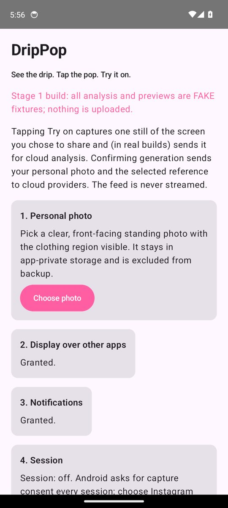
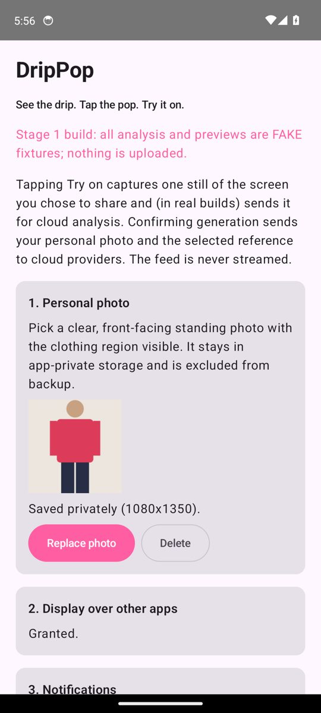
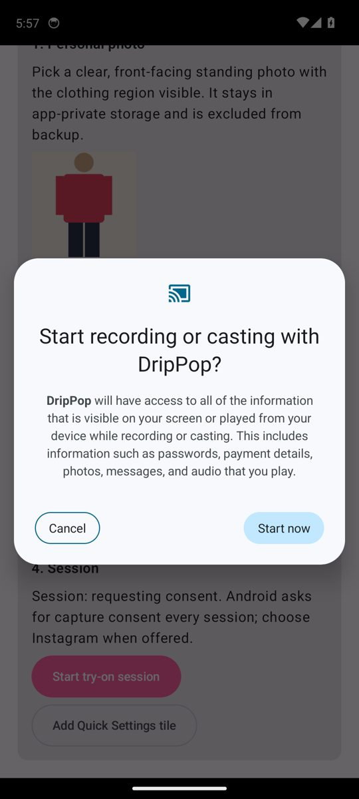
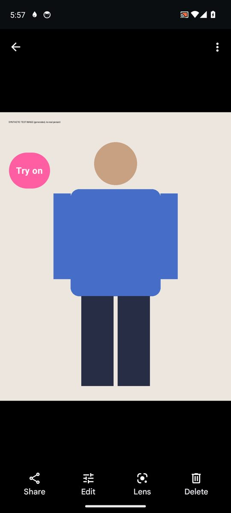
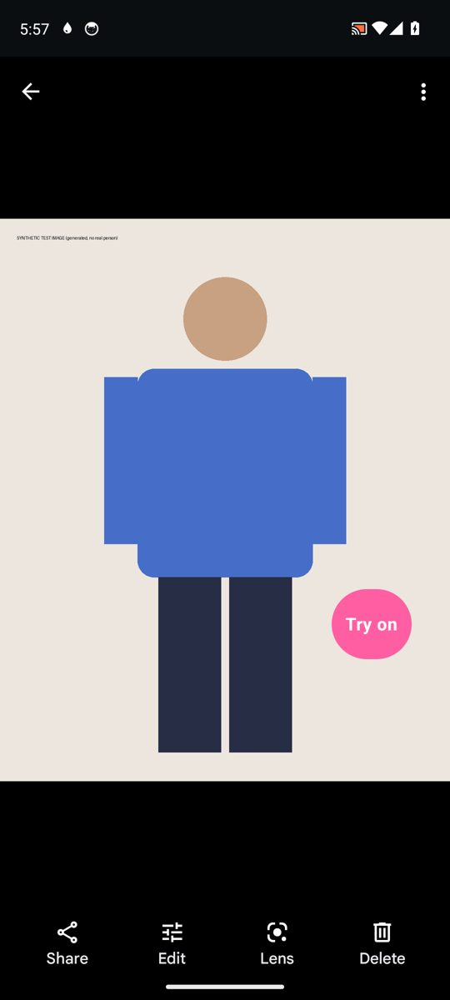
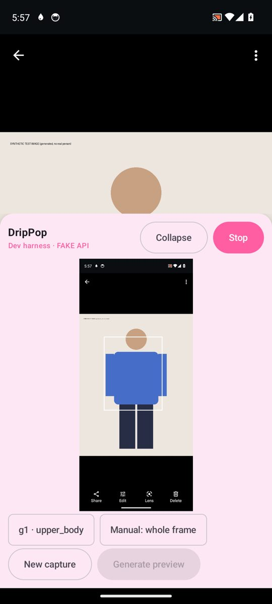
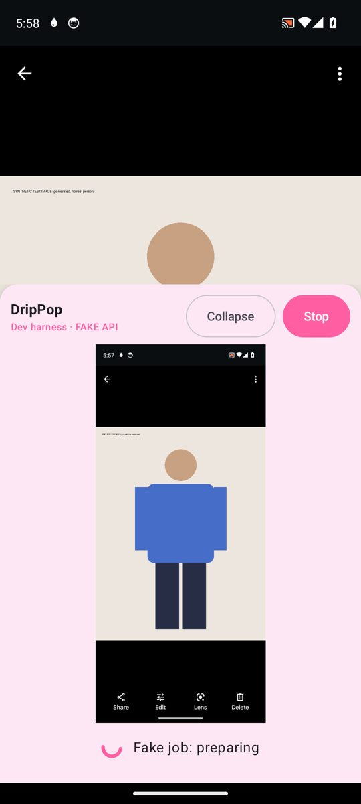
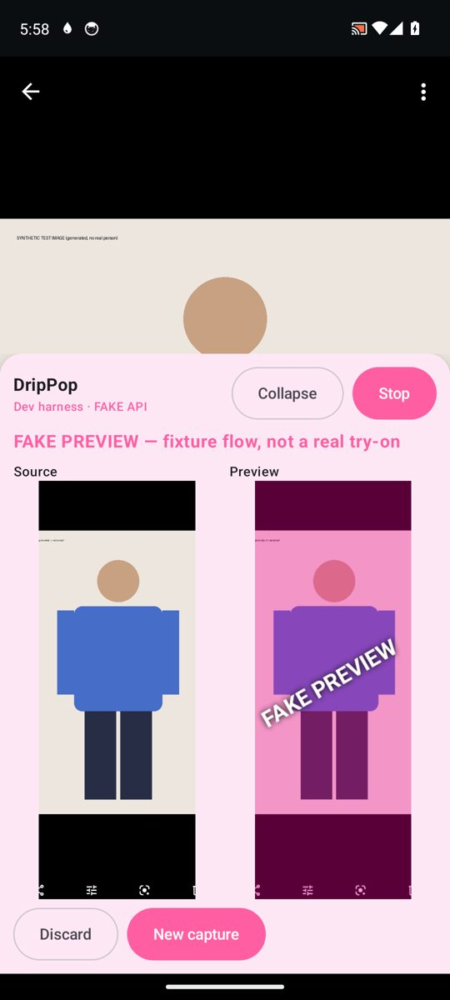
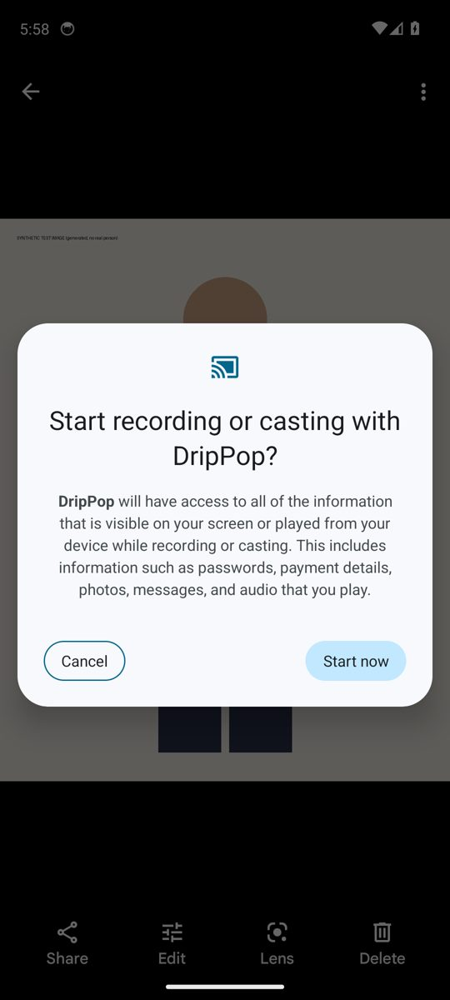

# Gate 1 — physical native proof (lane 1A)

**Status: PENDING.** Nothing in this file is a physical-device pass. Every Gate 1 item below is PENDING until
Peyton runs it on his Galaxy S24 with native Instagram and fills in the result column. Emulator results are in a
separate, dev-only section at the end and cannot pass this gate (PRD §8 Gate 1).

Build under test: debug APK from the lane 1A PR (`versionName 0.1.0-stage1`, fake API only — nothing is
uploaded; every result is a watermarked `FAKE PREVIEW`). Install: `adb install -r app-debug.apk`
(see `docs/runbooks/android-build.md`).

## Device record (fill in)

| Field | Value |
|---|---|
| Phone model | Galaxy S24 (model number: PENDING) |
| One UI / Android version / build number | PENDING |
| Security patch | PENDING |
| Instagram version (Settings → Apps → Instagram) | PENDING |
| DripPop APK commit | PENDING |
| Date / tester | PENDING |
| Screen recording link (no private photos/frames in the public repo) | PENDING |

Use a consenting test account or public posts. Do not commit screenshots that show private feed content or
personal photos; link to private storage instead if needed.

## Checklist

Mark each row PASS / FAIL / PARTIAL with a one-line note. Steps are the script to follow.

### G1-1 Permissions and consent

| # | Step | Expected | Result |
|---|---|---|---|
| 1.1 | Fresh install, open DripPop. Tap **Open overlay settings**, leave the toggle **off**, go back. | Step 2 still says it is needed; **Start try-on session** stays disabled; no loop or crash. | PENDING |
| 1.2 | Grant "Display over other apps", go back. | Step 2 says "Granted."; Start is enabled. | PENDING |
| 1.3 | Tap **Allow** under Notifications, choose **Don't allow**. Then grant from **Settings**. | Denial shows the Settings route; no repeated prompt loop. | PENDING |
| 1.4 | **Choose photo** → system Photo Picker → pick a consenting standing photo. | Thumbnail + "Saved privately"; no storage permission prompt. **Replace**/**Delete** work. | PENDING |
| 1.5 | **Start try-on session** → in the system dialog tap **Cancel**. | Toast "Capture not started…"; no bubble; no immediate re-prompt. | PENDING |
| 1.6 | Start again → choose **A single app** → **Instagram** (or entire screen; record which). | Instagram opens/is shown; "Try on" bubble appears; ongoing "capture session" notification with **Stop**; status-bar cast icon. | PENDING |

### G1-2 Capture of current post and reel still; own UI excluded

| # | Step | Expected | Result |
|---|---|---|---|
| 2.1 | In the Instagram feed, stop on a post with a visible outfit. Tap **Try on**. | Panel expands with the captured still matching the post on screen at tap time. | PENDING |
| 2.2 | Inspect the captured still in the panel. | No DripPop bubble/panel visible inside the still. | PENDING |
| 2.3 | Open a Reel, pause it on an outfit frame, tap **Try on**. | Still matches the paused frame (not an earlier frame). | PENDING |
| 2.4 | Scroll to a different post, tap **New capture**. | New still is the new post — never the previous one (no stale frame). | PENDING |

### G1-3 Selection / progress / result over Instagram; pass-through touches

| # | Step | Expected | Result |
|---|---|---|---|
| 3.1 | After capture, wait for fake detection. | Box drawn on the still + chip `g1 · upper_body` + **Manual: whole frame**. | PENDING |
| 3.2 | Tap the box or chip, then **Generate preview**. | "Fake job: preparing/…" progress, then **FAKE PREVIEW** source/preview comparison, all inside the overlay over Instagram. | PENDING |
| 3.3 | With the panel expanded, swipe the visible part of the Instagram feed above the panel. | Feed scrolls; the panel only intercepts touches inside itself. | PENDING |
| 3.4 | **Collapse**, then drag the bubble around. | Bubble follows the finger, stays on-screen; touching elsewhere scrolls/taps Instagram. | PENDING |
| 3.5 | TalkBack (optional): focus the bubble. | Announces "Try on. Captures one still…". | PENDING |

### G1-4 Rotation / capture resize

| # | Step | Expected | Result |
|---|---|---|---|
| 4.1 | Enable auto-rotate, rotate to landscape on a Reel, tap **Try on**. | Still is upright and not stretched/cropped incorrectly; detection box aligns with the still. | PENDING |
| 4.2 | Rotate back to portrait, tap **New capture**. | Upright portrait still of the current content, not the landscape one. | PENDING |

### G1-5 Switching away from the selected app (single-app share only)

| # | Step | Expected | Result |
|---|---|---|---|
| 5.1 | With an Instagram single-app session, switch to another app. | Bubble shows **Paused**; expanded panel collapses (private preview hidden). | PENDING |
| 5.2 | Tap **Try on** while away. | "The shared app is not visible…" — no frame of the other app or a hidden Instagram frame. | PENDING |
| 5.3 | Return to Instagram. | Bubble returns to **Try on** and capture works without a new consent prompt (same session). | PENDING |

### G1-6 Stop paths release resources and remove windows

| # | Step | Expected | Result |
|---|---|---|---|
| 6.1 | Panel **Stop**. | Bubble/panel gone, notification gone, cast icon gone. | PENDING |
| 6.2 | Start again (new consent), then notification **Stop**. | Same as 6.1. | PENDING |
| 6.3 | Add the Quick Settings tile (**Add Quick Settings tile** or edit QS). Tap it. | Consent dialog appears (fresh consent); accept → bubble. | PENDING |
| 6.4 | Tap the tile again while active. | Session stops; same as 6.1. | PENDING |
| 6.5 | Repeat start/stop 5×. | No leftover bubbles/panels, no crash, no duplicate notification. | PENDING |

### G1-7 Lock / system stop

| # | Step | Expected | Result |
|---|---|---|---|
| 7.1 | With a result visible, press power to lock. | Session ends; after unlock no bubble/panel/photo remains; next start asks for consent again. | PENDING |
| 7.2 | Start a session, stop it from the system cast/screen-share chip (status bar). | Same as 6.1; tile shows Off. | PENDING |
| 7.3 | Tap the tile on the lock screen. | Asks to unlock first; nothing private is shown over the lock screen. | PENDING |

### G1-8 Protected content

| # | Step | Expected | Result |
|---|---|---|---|
| 8.1 | Open a FLAG_SECURE screen (e.g. a banking app or a DRM video; or Instagram DMs if it blocks capture) with an entire-screen session, tap **Try on**. | "This screen is protected and can't be captured…"; no black frame is submitted; nothing tries to bypass. | PENDING |

## Known limits of this build (not Gate 1 failures by themselves)

- Fake API only: detection always returns the `contracts/fixtures/valid/detection-response.json` box; the
  preview is the reference crop tinted and watermarked `FAKE PREVIEW`.
- Panel/bubble UI is a platform dev harness; lane 2B owns the real overlay UI.
- Protected-content detection is a conservative "all-black frame" heuristic.

---

## Emulator results — DEV-ONLY (not Gate 1 evidence)

Environment: Android Emulator 37.2.12, AVD `dp34` (Pixel 7 profile, `system-images;android-34;google_apis;x86_64`,
Android 14), headless with KVM, 2026-10-11. No Instagram on the emulator: the "running app" is Google Photos
showing a **generated synthetic figure** (no real person, created by script). Overlay/notification permissions
were granted with `appops`/`pm grant`; the tile was added/clicked with `cmd statusbar`.

| Check | Dev-only result |
|---|---|
| Onboarding renders; Photo Picker import to app-private storage | Observed working (s1, s2) |
| MediaProjection consent dialog (API 34 image: entire-screen dialog only, no single-app picker) | Shown from app button and tile (s3, s12) |
| Foreground service type | `dumpsys`: `isForeground=true types=00000020` (mediaProjection) |
| Bubble over another app; drag | Bubble over Google Photos and moves on drag (s4, s5) |
| Capture excludes own UI; fake detection box + chips | Captured still has no bubble; `g1 · upper_body` box aligned (s7) |
| Fake job progress → `FAKE PREVIEW` | Observed (s9, s10) |
| Panel Stop | 0 `DripPopOverlay` windows, service gone, notification gone |
| Tile start → consent → bubble; tile stop | 1 window after start, 0 after stop |
| Consent Cancel | No bubble, no service, returned to previous app, no re-prompt |
| Not exercised on emulator | Single-app share/visibility changes, rotation, lock, protected content, Instagram |

Screenshots (emulator, dev-only, synthetic content):

| | |
|---|---|
|  |  |
|  |  |
|  |  |
|  |  |
|  | |
